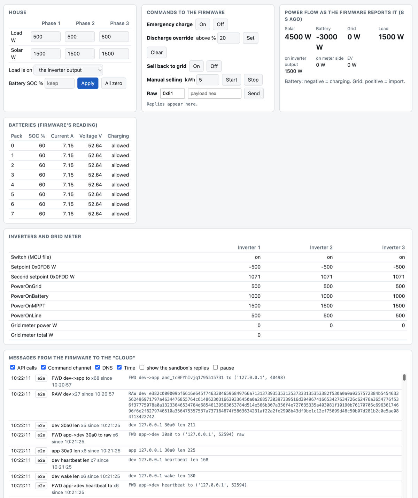

# Emaldo firmware emulator

A sandbox that runs the **official Emaldo module firmware** (the 31 MB Go
application from the IoT module) on a virtual Power Core, with a fake local
cloud, so you can study, poke, and test it without touching real hardware.
This is the test bench `emaldo-local` development uses for the OTA round-trip
and protocol experiments.

> Status: **the official app boots and stays up** (verified 2026-11-23). The
> last reboot gate - the Bluetooth driver-reload escalation, gate #4 - is
> cleared: the virtual controller now completes HCI init so the adapter reports
> `UP RUNNING`, and past that point the app walks `iot.Start`, opens its 9
> leveldb stores, binds the tower UDP socket (`*:9332`), starts BLE
> advertising and waits in `tower/connfork` for the cloud side of the e2e
> tunnel. Everything else works too: the fake BMS cabinet registers over vcan,
> the app attaches to the cabinet FIFOs, the network/backlight/screen gates are
> emulated, and pprof is live (the app binds **:16061**, not 6060).
>
> **Update (2026-11-24 19:00): the cloud login is reached.** Two gates
> opened this evening. (1) The firmware's HTTP/2 client sets
> `SO_BINDTODEVICE eth0` and cannot connect to loopback at all - with that
> option, connects to `127.0.0.1:443`, `1.1.1.1:443`, `8.8.8.8:443` rot in
> `SYN-SENT` while an on-link `10.0.2.15`/`10.0.2.3` address works. Everything
> (sandbox API, DoH front, zone answers) therefore lives on eth0; the DoH
> literals are claimed on eth0 and NATed to the front by `dnshijack`. The front
> and the API used to collide on `10.0.2.3:443`; the front now runs on
> `10.0.2.15:443`. (2) The state machine's `Unconfigured` gate is **config
> identity**, not the encrypted `baseinfo` record: `appdata.IsConfigured`
> requires `app_id`/`app_secret`/`cloud_token`/`home_id`/`base_url`, fed from
> `/root/config.toml`. With those set the app runs `(*Configured)` and calls
> `/bmt/e2e-bmt-login`, `/bmt/get-electricity-price-percents-v2`,
> `/bmt/metrics/auth/get-forecast-solar` (see `/sandbox/api_req.log`). The next
> gate it hit was `/dev/ttymxc2` (the MCU UART, `iot.go:546`); `ttymxc2-stub.py`
> provides a pty and the app polls it every ~4 s. `baseinfo_v1` is the app's
> own filedb bucket store and grows when the identity is persisted - do not try
> to forge it. Full analysis: `docs/EMALDO_STATE_GATE.md`; bench notes:
> `~/src/homeassistant/emaldo-capture/HANDOFF_EMULATOR.md` §4b.>
> **Update 2 (2026-11-24 20:45): the panel is readable and the e2e loop is
> understood.** The app renders into `/dev/fb0` with a plain `mmap` (15001
> bytes, 400x300 1 bpp, no ioctls), so `vmfb-file.service` backs it with a
> regular file (`/sandbox/fb0.raw`) - never register a real fbdev, fbcon
> takeover oopses in `sys_imageblit`. Read the file back (MSB-first, 1=black)
> and the official UI appears: Solar/Grid/Battery, Vehicle/KeepOn/Addition,
> status icons, centre box; all values are 0 kW because `/dev/ttymxc2` is the
> Modbus inverter/BMS bus and the stub does not answer its 4 s polls.
> `/bmt/e2e-bmt-login` every 10 s is the module's *rejection retry* (see
> `docs/PROTOCOL.md`), not live behaviour; replaying a captured real response
> (`/sandbox/e2e_login_real.json`, never commit) stopped the loop and the relay
> saw `dev 10.0.2.15 alive` every 10 s. The reboot also showed what was only
> done by hand before: the DoH literals `1.1.1.1/32`/`8.8.8.8/32` are now in
> `20-emu.network`, `vcan`/`can-raw` and the HCI stack are loaded by path (the
> modprobe/execlog wrapper cannot resolve module names), the fake `/dev/fb0`
> and pty stub are units ordered before `exp-hb`, and portal204/e2e-relay/
> bt-stub are enabled. Containment-check is 20/20 PASS after a clean boot.
>
> **Update 3 (2026-11-25): the diagchan is reachable and gives a shell.** The
> e2e connfork chooses the router **per message**, not per login: an
> `A0="SERVER"` header sends the frame to the CloudConn (JSON-decoded,
> `cloudr`), while `F1` (proxy) sends it to the UserConn (`usersr`). `dc_act`
> lives in `cloudr`; appending a duplicate `A0="SERVER"` (and omitting `F1`)
> makes an app-channel frame run `diagchan.Activate`. Pass **`lp=0`** so the
> handler uses its default local port `0xE792 = 59282`, the module's diag
> sshd; the reply `DcActRsp` carries the tunnel `cmd` and the child `pk`,
> which is authorized on the jump sshd. A fresh local user (uid>=1000,
> diagchan-created) and the full `ssh-ed25519 ...` key line are required.
> Verified end to end on the emulator and on a live module **without an OTA**.
> Recipe and exact frame in
> [`../docs/EMULATOR_BENCH.md`](../docs/EMULATOR_BENCH.md) ("Diagchan
> reachable on the app/users e2e channel").
>
>
> QEMU user-mode was abandoned midway (timing races); the supported path is
> **QEMU system-mode** (full ARM VM). The notes on why are kept at the bottom -
> they will save you from re-trying it.

> Bench operations (units, gates checklist, log map, probes, network map, open
> gaps): [`../docs/EMULATOR_BENCH.md`](../docs/EMULATOR_BENCH.md).

## Architecture

```
  qemu-system-arm -M virt (ARMv7 VM, Debian armhf rootfs)
  ├─ systemd
  │   ├─ emaldo.service        -> /app/emaldo_iot_fw   (the OFFICIAL app, native ARM)
  │   ├─ sandbox-api.service   -> sandbox_api.py        (fake Emaldo cloud API, TLS :443)
  │   ├─ vcan.service          -> modprobe vcan; can0 up (kernel virtual CAN)
  │   ├─ fake-bms.service      -> fake_bms.py + fake_bak.py (cabinets and their BAK batteries on can0)
  │   ├─ serial-tap.service    -> serial_tap.py         (stand-in /dev/ttymxc2 + /dev/ttyCH9344USB0-7, logged)
  │   ├─ mcu-sysfs-stub.service -> mcu-sysfs-stub.sh    (/sys/class/mcu/mcu1: inverter switches)
  │   ├─ spy-sink.service      -> ws_sink.py            (receives the app's decoded readings, /sandbox/spy.out)
  │   ├─ hps-net-state.service -> writes netctl eth0.env state (boot gate #2)
  │   ├─ screen-mcu-stub.service -> screen_state, /dev/mcu1*, backlight overlay (#3)
  │   └─ sshd + serial console on ttyAMA0
  ├─ /root/bin/cabinet         -> REAL canapp binary    (immutable; bridges can0 <-> app)
  ├─ /usr/sbin/{reboot,systemctl,...} -> ONE multi-call stub (tool-stub.sh; #1)
  ├─ /usr/sbin/modprobe        -> modprobe-stub.sh      (#4: fake btusb reload)
  ├─ /usr/local/sbin/ip        -> ip-vcan.sh            (keeps can0 up: drops "type can ..." on vcan)
  ├─ /opt/vmfb/vmfb.ko         -> fake /dev/fb0 (e-ink capture, see vmfb/)
  ├─ dns-sink.service          -> dnssink.py            sinkhole DNS :53 + DoH front :443 (containment)
  ├─ dnshijack.service         -> dnhijack.py           NAT 1.1.1.1/8.8.8.8:443 -> DoH front
  ├─ ttymxc2-stub.service      -> ttymxc2-stub.py       pty /dev/ttymxc2 (MCU UART; gate #5)
  ├─ portal204.service         -> portal204.py          captive-portal 204 on :80
  └─ /etc/systemd/network/20-emu.network  static eth0 + resolver aliases (containment)
```

The app generates a **fresh random device identity** on first boot - it never
collides with a real battery.

## Egress containment (the vendor cloud is still operating)

Emaldo is bankrupt but its endpoints still resolve and answer. Nothing the
firmware does in the VM may reach them, and the app actively tries: it resolves
vendor names itself, and it probes `cp.cloudflare.com` about every 10 s to judge
whether it has internet. Four layers, all inside this repo:

| Layer | Mechanism | Proof |
|---|---|---|
| No route out | QEMU user-net `restrict=on` (`start-vm.sh`): slirp refuses every guest connection, including DNS it would forward on the host | guest `connect(104.26.5.120:443)` -> `ECONNREFUSED` |
| No real answers | `dnssink.py` (systemd `dns-sink.service`) listens on 0.0.0.0:53; `/etc/dnssink.conf` maps the vendor zone to the sandbox, the connectivity-probe names to the sandbox, everything else NXDOMAIN | `gethostbyname(files.oms.emaldo.com)` -> `127.0.0.1` |
| Its own resolver values land locally | the firmware's `netmonitor` **owns `/etc/resolv.conf`**: it unlinks and recreates it (so `chattr +i` is cleared) and writes `1.1.1.1` + `8.8.8.8`. The sink unit therefore claims those addresses plus slirp's `10.0.2.3` as local (lo aliases / static `20-emu.network`) | raw DNS to each of `127.0.0.1`, `1.1.1.1`, `8.8.8.8`, `10.0.2.3` returns 54 bytes from the sink |
| The link check must pass locally | the probe must answer 204, otherwise the app calls the link down and never starts its cloud stage: `portal204.py` on :80 and `/generate_204` in `sandbox_api.py` on :443 | `HTTP/1.1 204 No Content` from the TLS probe |

Consequence for the topology: with `restrict=on` the guest cannot reach the host
either (`10.0.2.2:19999` -> `ECONNREFUSED`), so every responder - API sandbox,
e2e relay, portal - runs **inside** the guest: `sandbox_api.py` defaults to
`E2E_RELAY=10.0.2.3` (an eth0 address; loopback is unreachable to the app) and
the relay runs as `e2e-relay.service` with
`E2E_BASE=/sandbox` and `EMALDO_VENDOR_LEG=0` (the bridge toward the vendor
relay would resolve to the guest itself and loop). The tripwire is
`/var/log/dns_queries.log`: it records every name the firmware asks for, so the
name set is discovered, and an unknown name is a visible event rather than a
silent leak. Measured first tally: `cp.cloudflare.com` x38 (its link check),
`files.oms.emaldo.com` x12; `api.emaldo.com` never appears because `/etc/hosts`
answers it before DNS.

Verify after any network change (all from inside the guest):

```
python3 -c "import socket;print(socket.gethostbyname('files.oms.emaldo.com'))"   # 127.0.0.1
python3 -c "import socket;socket.create_connection(('104.26.5.120',443),5)"      # must raise
tail -20 /var/log/dns_queries.log                                               # tripwire
```

## Boot gates (the app reboots whenever one is unmet - found in order)

1. **Bluetooth config-by-reboot.** The
   app applies bluetooth configuration by REBOOTING: goroutine 1 reaches
   `bluetoothctrl.(*reloadable).Start` (iot.go:343) ->
   `shell.Exec(ctx, "reboot")`. Every boot it runs
   `systemctl is-enabled/disable/mask bluetooth.service` and then reboots "to
   apply". On real hardware exactly one config reboot happens, then the state
   persists. The stateless stub made every boot look like the first.
   **Fix: the stateful multi-call stub** (`tool-stub.sh`),
   installed under EVERY name the app shells out to (reboot, shutdown,
   systemctl, gpioget, dmesg, hostnamectl, ifconfig, aplay - `/usr/sbin/
   systemctl` is a separate file by default and forgetting it silently
   disables the whole fix). The stub prints realistic stdout ("masked",
   "inactive") - the app parses it, exit codes alone are not enough - and
   records `disable`/`mask` in `/root/.stub_state/` on the persistent fs.
   NOTE: with that stub in place the box *still* rebooted - `reloadable.Start`
   has a second, independent reboot branch, see gate #4. Masking the unit only
   silences the disable/mask branch (no `systemctl disable/mask` lines in
   `/var/log/stubs.log` afterwards).
2. **Network state file.** The app polls `/run/hps/networking/eth0.env` ~1/s
   for ~6 s (written on real hw by the netctl/dhclient hooks), and its own
   `netctl-supervisor` watchdog DELETES the file whenever no dhclient process
   exists (the VM uses networkd). Fix: `hps-net-state.service` copies the
   live lease into the expected format, then `chattr +i` the file - the
   supervisor's `rm` fails with EPERM and the gate stays green. NOTE: the
   minimal rootfs has **no awk/sed** - hps-net-state.sh is pure shell.
3. **Front-panel screen MCU.** The app reads `/run/screen_state` (written by
   the kernel mcu driver on real hw after the display handshake; any string
   that is not `power_off`/`low-power`/`upgrading` is healthy), writes
   `/sys/class/backlight/backlight-display/brightness` (the class dir exists
   in the stock kernel but is empty - `screen-mcu-stub.sh` overlays a tmpfs
   and creates the device), and only then opens `/dev/mcu1`/`/dev/fb0` for
   the display pipeline. The app never opens the mcu char devices during
   bring-up.
4. **Bluetooth driver reload escalation (`reloadable.Start`, iot.go:343).**
   The app (a) enumerates services (`systemctl is-enabled networking/netctl/
   bluetooth`, then `disable --now` + `mask bluetooth.service` - gate #1),
   (b) runs the reload routine at **0x00c01060**, which executes **`lsmod`** and
   matches it against `aic_btusb` (AICSemi) / `rtk_btusb` (Realtek), (c) if the
   vendor module is not right, runs the pair `modprobe -r <mod>`,
   `modprobe <mod>` - twice, each command under a ~1 s `context.WithTimeout` -
   and (d) if that still fails calls `shell.Exec(ctx, "reboot")` (pprof:
   `reloadable.go:50 +0x248` = the `blx r1` at 0x00c020cc) **and returns an
   error**, so main exits 1. Verified from the service strace:
   `modprobe -r aic_btusb` / `modprobe aic_btusb` x2 at ~3-6 s spacing, then
   `execve("/bin/bash",["-c","reboot"])` -> `execve("/usr/sbin/reboot")` ->
   `exit_group(1)`.
   Historical failures, in order of discovery:
   - `lsmod` did not exist (the app deletes `/lib/modules` and the kmod
     aliases; see gotcha 12) -> `exec.LookPath("lsmod")` error, no reload
     commands at all, reboot with zero BT-related syscalls in the trace. That
     is why the first traces looked "syscall-free".
   - After kmod was repaired, `lsmod` worked, the vendor was picked
     (AICSemi) and the modprobe pair ran, but the stub's `$(date)` fork made
     each call exceed the 1 s timeout -> "failed" -> reboot (gotcha 14).
   **Fix (verified 2026-11-23): both halves are needed - the module names AND a
   controller that actually initialises.** (i) `btmod/` builds two no-op modules
   named exactly `rtk_btusb` and `aic_btusb`; copy them into
   `/usr/lib/modules/$(uname -r)/kernel/net/bluetooth/`, run `depmod -a`, and
   list them in `/etc/modules-load.d/btmod.conf`, so real kmod answers `lsmod`
   and the modprobe pair. (ii) The reload routine's last step is the HCI device
   list (ioctl `HCIGETDEVLIST`, whose per-entry `dev_flag` carries `HCI_DEV_UP`)
   and its own BLE bring-up: an `hci0` that exists but sits in INIT is *not*
   enough - the adapter has to reach `UP RUNNING`. That takes `bt-stub.service`
   (enabled: check `systemctl is-enabled bt-stub`, the wants symlink is easy to
   lose) running `modprobe hci_uart` + `btattach -B /dev/ttyAMA1 -P h4` against
   the host `h4_shim.py`, and the shim must answer each command with the *exact*
   Command Complete struct size: the kernel's `hci_cc_*` handlers log
   `Bluetooth: hci0: unexpected cc 0x0c14 length: 9 < 249` when they get a wrong
   one, and the resulting `-38` leaves the adapter DOWN. `h4_cmds.json` holds
   those lengths (10 opcodes) and `h4-fix.py` grows it by replaying the guest
   journal until `hciconfig hci0 up` succeeds - 8 iterations from scratch.
   With `hciconfig -a` showing `UP RUNNING` the escalation stops: no new
   `SUPPRESSED` line in `/var/log/stubs.log`, and the goroutine dump moves on to
   `sockets/ble.(*Ble).Advertise` + `tower/connfork`.
   What does NOT work: `/root/config.toml` keys `reboot_bluetooth = false` and
   `reboot_batteries = false` (tested, escalation unchanged - those keys belong
   to the OTA/update subsystem), and neutering `/usr/sbin/reboot`:
   `reboot-stub.sh` (log + `exit 0`) only makes the app *exit 1* right after the
   request (tool-stub rule 1) - useful as instrumentation (the `SUPPRESSED` line
   marks the exact decision point) but it does not get you past gate #4.

5. **State gate (`Unconfigured`) and the MCU UART.** This one is not a reboot
   loop: the app sits in `staterunners.(*Unconfigured)` forever. It is opened by
   **config identity**, not by the `baseinfo_v1` record: `AppWizard.update`
   calls `appdata.IsConfigured`, which is true iff `GetAppID`, `GetAppSecret`,
   `GetHttpBaseURL`, `GetCloudToken`, `GetHomeID` are all non-empty, and
   `appdata.FromConf` fills those from the main config (`app_id`, `app_secret`,
   `base_url`, `cloud_token`, `home_id`; also `data_url`, `model`). Put the
   public app id/secret plus a lab cloud token in `/root/config.toml` and the
   app moves to `(*Configured)` and starts real `/bmt/...` API calls
   (`/sandbox/api_req.log`). The very next moment it FATALs at
   `iot.go:546 - failed to create mcu sock` = `openat("/dev/ttymxc2")`: the MCU
   UART must exist. `ttymxc2-stub.py` (unit `ttymxc2-stub.service`,
   `Before=emaldo`) creates a pty, symlinks it to `/dev/ttymxc2`, and logs the
   app's frames to `/sandbox/ttymxc2_traffic.log` (~4 s cadence; the frames
   are Bmtp, e.g. `00 00 01 06 00 15 00 05 10 00 00 06` = ProtocolVersion 0,
   Type 0 (request), Platform 1, Length 6, Id 0x0015, Command 0x1005,
   CommandVersion 0, Encryption 0, XOR 0x06). The stub does not answer; the
   app still proceeds and runs the cloud stage. `fake_mcu.py` answers the
   read-only set (see "MCU responder and CAN replay" below).
   Notes: `baseinfo_v1` is the app's own filedb bucket store and grows when the
   identity is persisted (1900 -> 2743 B) - do not forge it. One more loopback
   trap at this stage: the e2e credentials the API hands out must name an eth0
   address (`E2E_RELAY=10.0.2.3` in `sandbox-api.service`); with
   `127.0.0.1:1050` the eth0-bound app can never reach the relay and re-runs
   `e2e-bmt-login` forever. The netmonitor
   classifies a link up via `BaseLink.Online()` (cached bool), refreshed only
   while the base link's `LinkState` is `ok`, from the prober's `internetOK`:
   a successful DoH exchange through the 1.1.1.1/8.8.8.8 fronts, or an HTTP 204.
   Do not read `netmonitor.go:81` / `appwizard.go:101` as failures - both are
   the normal `runtime.selectgo` waits.

After the gates: the app walks to `iot.Start` (pprof shows `iot.go:1539`),
opens 9 leveldb stores, binds its tower UDP socket (`*:9332`), starts BLE
advertising and parks in `tower/connfork.(*downstream).Recv`. With the state
gate open (gate #5) it also runs `staterunners.(*Configured)` +
`OperationCommon` + `ConfiguredDisplay` + `cloudr/updater` + `msct/e2e` and
issues `/bmt/e2e-bmt-login`, `/bmt/get-electricity-price-percents-v2`,
`/bmt/metrics/auth/get-forecast-solar` to the sandbox API on `10.0.2.3:443`
(DoH front on `10.0.2.15:443`; the two used to collide on `10.0.2.3:443`). The
sandbox hands out e2e creds naming `10.0.2.3:1050` (`util 10.0.2.3:1051`) and the
guest relay (`e2e-relay.service`) accepts them; `/sandbox/relay_live.log` then
shows `dev 10.0.2.15 alive` every ~10 s. Do not point the creds at the host
(`10.0.2.2`) or loopback: with `restrict=on` and `SO_BINDTODEVICE eth0` the app
cannot reach either. Instrument that stage with `SB_LOG` (set it to `/sandbox/...`, not
`/var/log`: gotcha 3), because the relay has not yet reported a device session
from the VM. Next milestone: get the MSCT tunnel up (relay join), then FCR/MQTT
pokes and the OTA round-trip.

## Debugging playbook (this is how every gate was cracked)

- **pprof is the killer tool**: `/root/config.toml` with `enable_pprof = true`
  exposes `http://127.0.0.1:16061/debug/pprof/goroutine?debug=2` from ~20 s
  into boot. The app BLOCKS inside the reboot call for the whole
  delayed-reboot grace, so it is snapshot-able at leisure. goroutine 1's
  stack names the exact bring-up stage; watching it walk down `iot.go` line
  numbers = a live boot progress bar. SIGQUIT dumps work too but pprof needs
  no timing luck.
- **strace the service** (`-e trace=process,openat,read,write,connect,socket,
  ioctl,poll,ppoll,epoll_wait,futex`) and read the LAST boot's trace: the
  final 200 ms before the `execve(".../reboot")` show the deciding checks.
  `-o` truncates per Restart=always cycle - only the last boot is kept.
- **The stub invocation log** `/var/log/stubs.log` is the app's boot sequence
  map. If a line you expect is missing, the app never got there.
- **THE SINGLE-INSTANCE RULE**: never run two app processes. They fight over
  leveldb LOCK files, spin at 100% CPU each (load 20+ on one vCPU), wedge PID
  1 into D-state ("Transport endpoint is not connected" from systemctl), and
  corrupt each other's db. `systemctl stop emaldo` + kill every
  `emaldo_iot_fw`/`strace` + verify with pgrep BEFORE any manual run, and
  remember the systemd unit has Restart=always (it resurrects instances
  unless stopped/masked). After a wedge: kill QEMU, `fsck.ext4 -y`, reboot.
- **Console/ssh**: sshd in the minimal rootfs needs hand-holding: create
  `/etc/ssh/sshd_config` (it may be MISSING), generate host keys, add the
  `sshd` user, `PermitEmptyPasswords yes`, `RuntimeDirectory=sshd`. Empty the
  root password for console+ssh. QEMU serial socket accepts ONE client -
  kill hung console scripts before reconnecting; backgrounded children with
  inherited stdout hang ssh (use `setsid ... </dev/null >log 2>&1 &`).
- **Offline image surgery**: kill qemu by exact PID (`pgrep -x
  qemu-system-arm` - never `pkill -f`, it matches your own shell),
  `fsck.ext4 -y`, `mount -o loop`, edit, umount, boot. The image is a
  whole-disk ext4. Guest writes go straight to the image - editing files
  inside the running VM IS persistent.

## Cabinets and batteries (verified against the running app, v2.35.3)

Status 2026-11-23: with the pieces below the app discovers the cabinets, takes
every battery in them as a BAK pack and reads it about twice a second. Checked
with one internal cabinet of 3 packs plus one external cabinet of 5: the app's
own debug feed reports `battery/0` ... `battery/7` with the values the fake
sends (52.64 V, 60 % SoC, 16 cell voltages, six temperatures, cycles, health).

### What the app needs before it talks to anything

- **It must be "configured".** A fresh device sits in the wizard state
  `Unconfigured` (goroutine `appwizard/staterunners.(*Unconfigured).Run`): it
  attaches to the cabinet FIFOs but never sends a byte, and the whole
  peripheral side (`hermes`) is not started. `appdata.IsConfigured` is true
  when app id, app secret, base URL, cloud token and home id are all
  non-empty, and all five can be given in `/root/config.toml`
  (`config.toml.example`).
- **`/dev/ttymxc2` must exist** (the MCU serial port). Without it the
  configured app dies in a loop: `failed to create mcu sock: no such file or
  directory`. `serial_tap.py` puts a pty there.
- **`/dev/ttyCH9344USB0-3` are not batteries.** The app sends Modbus RTU there
  (slave 1): ports 0, 2 and 3 get `01 03 0F A4 00 01`, later `0F A0`
  (1 and 15 words) - three identical devices, i.e. the inverters; port 1 gets
  registers `0x008D` and `0x0061` (the b-sensor). `serial_tap.py` logs them to
  `/sandbox/tap.out` and stays silent; the app carries on without replies.
- **can0 must stay up.** canapp and the app's CAN monitor run
  `ip link set can0 down` / `ip link set can0 up type can restart-ms 1000` (or
  `bitrate 500000`). vcan rejects `type can`, the link stays DOWN and the
  cabinets vanish. `ip-vcan.sh` installed as `/usr/local/sbin/ip` drops those
  arguments.

### The bus (from canapp's code, confirmed on the wire)

The app never touches CAN. `canapp` (`/root/bin/cabinet -t 2`) bridges can0 to
FIFOs: `/run/cabinet/<cab>/{in,out}` for a cabinet and
`/run/cabinet/<cab>/<seat>/{in,out}` for each battery, listed in
`/run/cabinet/tree`.

```
  CAN id:  bits 25-28 type | bit 24 flag | bits 16-23 page | 8-15 source | 0-7 dest
  address = cabinet << 4 | battery seat (seat 0 = the cabinet); canapp = 0x00
  canapp only accepts dest 0x00 or 0xFF
  longer than 8 bytes:  first frame flag 1, page = N (page count)
                        frames 2..N  flag 0, page = k;  length = (N-1)*8 + last dlc
  single frame:         flag 1, page 1
```

| type | direction | meaning |
|---|---|---|
| 5 | canapp -> all (`0x8B0100FF`, payload `04`, every 2 s until answered) | discovery |
| 5 | cabinet -> canapp | `05 mask uuid(8)`; mask **bit 7 = seat 1**, bit 6 = seat 2 ...; cabinet 1 takes seats 1-3, others 1-5 |
| 7 | both | battery tunnel: raw bytes of `<cab>/<seat>/out` to dest `cab<<4|seat`, replies from that source into `.../in` |
| 9 | app -> cabinet (Din TLV 2), about 2 per s | status; reply >= 7 bytes `state b1 mask w_hi w_lo t_hi t_lo` |
| 10 | app -> cabinet (Din TLV 4) | version; reply 24 bytes, three 8-byte strings |
| 2 | app -> cabinet (Din TLV 3) | set battery status, 2 bytes |

- The old fake used mask `0x07`, which canapp reads as seats 6-8 and rejects -
  that is why the tree never showed a battery.
- canapp polls only until the first cabinet answers and then writes the tree
  **once**; all cabinets have to answer that same poll.
- **A status reply shorter than 7 bytes panics the app** (`index out of range
  [5] with length 5` in `peripherals/cabinet.(*Cabinet).ReadData`). State byte:
  bit 3 = bootloader, else bits 0-1.
- Toward the app, canapp wraps cabinet replies as `"Din" len(2, BE) T L data
  xor8`; the app reads at most 48 bytes and wants TLV type = the one it asked.

### The battery protocol inside the tunnel (BAK)

`START 00 GROUP LEN payload CHECK 0D`, `CHECK = xor ^ sum8` of everything
before it. The address byte is always `00`; the CAN address picks the pack.
The app reads exactly `LEN + 6` bytes per reply (length-prefixed, binary
safe) - a trailing LF breaks the next reply.

1. `7E 00 33 00 FC 0D`, up to 5 times at 2 s: the type probe
   (`resolver.ParseBatteryType`). A valid reply **longer than 8 bytes** means
   BAK; a 2-byte payload is looked up in a table for the other makes.
2. `7E 00 DC 03 06 00 00 C4 0D`: version string (two frames on CAN).
3. `7C 00 01 00 00 0D`, about twice a second: basic data, blocks
   `id n n*u16`: 1 cell mV, 2 current `30000 - mA/10`, 3 SoC x100,
   4 capacity x100, 5 six temperatures (`degC + 50`), 6 state, 7 cycles,
   8 pack voltage in 10 mV, 9 health x100, 10 protection.
4. `7E 00 25 00 F8 0D`, every ~11 s: current-limiting mode (an empty payload
   is accepted).

State block 6 (10 bytes), mapped by flipping single bits and reading the
app's decode: all zero = not charging, discharge MOS on;
`byte[2]` `0x40` charging, `0x80` charging through the limiter, `0x20`
discharge MOS off, `0x10` ChargeMOS -1, `0x08` LimitingMOS 1;
`byte[5] 0x10` heat film status 2; `byte[7] 0x20` heat film status 0.
No single bit of block 10 changes the decoded fields.

### Seeing what the app decoded: the spy feed

`hermes_spy = "ws://127.0.0.1:18765/spy"` in `/root/config.toml` makes the app
open a websocket and post every peripheral reading as JSON
(`{"channel":"spy","payload":{"name":"battery/0","cmd":"readdata","data":{...}}}`,
also `bsensor`). `ws_sink.py` (spy-sink.service) accepts it and appends to
`/sandbox/spy.out`. This is the only practical window into the app's state:
module debug logging needs `/etc/hps/logging.toml` whose `modules` field must
be stored encrypted.

### Knobs

```
fake-bms.service.d/*.conf:  Environment=BMS_CABINETS=1:3,2:5   # cab:batteries
                            Environment=BAK_SOC=60 BAK_CURRENT_A=10 ...
/sandbox/bak_off     pack ids (cab<<4|seat) that stop answering, live
/sandbox/bak_flags   raw hex for blocks 6 / 10, live
```

Not emulated: battery history, LIn-mode policy, battery and cabinet firmware
update, inverters, b-sensor, the MCU.

## Inverters, cloud stage and commands (v2.35.3)

The app drives three inverters over Modbus RTU, slave 1, one per port
(`/dev/ttyCH9344USB0`, `2`, `3`), with the `hisolar` driver. Two things have to
exist before it does more than probe them.

**1. A Modbus slave that remembers writes.** `serial_tap.py` answers reads
itself; choose how with `TAP_MODBUS`:

| Value | Answer |
|---|---|
| `zero` (default) | every register reads 0 |
| `store` | 0 until the app writes a register, then the written value |
| `addr` | each register reads its own address (for mapping fields) |
| `file` | values from `/sandbox/tap_regs`, lines `port-substring 0xADDR value`; a value may be an expression, see `tap_regs.example` |

The tap logs a repeated frame only the 1st, 2nd, 100th, 200th ... time, so a
steady poll shows as `(100x, ...)`, not as many lines.

**2. The MCU's sysfs directory.** The inverter on/off switches are not on
Modbus. They are files of the vendor mcu driver, `/sys/class/mcu/mcu1/
inverter_0..2`: the app writes `1` or `0` and reads the first byte back (`1` =
on). `mcu-sysfs-stub.sh` (unit `mcu-sysfs-stub.service`) creates the directory
by putting a tmpfs over `/sys/class` and binding the real class directories
back in. Other attributes it creates because the app names them:
`mcu_status`, `mcu_version`, `hardware_version`, `inverter_factory`,
`temperature`, `con_power`, `updata_mode`, `mcu_rst`, `ev_green`, `ev_red`.

What the app does with both in place (per inverter, in order):

| Step | Modbus |
|---|---|
| hardware version | read `0x0FA4` x1 |
| identity / state | read `0x0FA0` x1, `0x0FA0` x15, `0x0FDA` x1 |
| battery charging voltage | write `0x0FE0`=0, `0x0FDA`=560 (56.0 V), `0x0FE0`=1 |
| initial data | read `0x0FA0` x43, `0x0FCB` x57, `0x0FD3` x11, `0x0FAF` x18 |
| control | write `0x0FD3`=1 |
| powers (`BatchSetPowers`) | write `0x0FD8`..`0x0FDD` = `[0, 3600, 560, 3600, 0, 0]` |
| second pass, only with the MCU directory | re-read, then write `0x0FD8`=333 and `0x0FDD`=333 |

`0x0FD9` and `0x0FDB` are the maximum powers (the driver rejects values outside
+-3600). With the switches reported on at start, the app writes `0` to all
three files about 6 s after start and leaves them off.

**Why the inverters were held off: water alarm.** `fake_bms.py` sent 0 in
the cabinet status reply's water sensor word. Below 620 the app raises error
`0400` (`Cabinet.ProcessWaterSensorStatus`), switches the inverters off about
40 s later, stops polling them and remembers that in `/root/db`
(`invs_ctrl_status`, `global_errors`), so later boots start switched off.
`0401` is `CabinetHealthCheckFailed`. With a dry sensor (default now) and a
reset database (`systemctl stop emaldo; rm -rf /root/db/*`) the app writes `1`
to `inverter_0..2`, polls each inverter about every 0.7 s without stopping, and
writes power setpoints: `0x0FD8`=`0x0FDD`=533 about 16 s after start, back to 0
about 40 s later. Error `8003` stays set; it does not stop this.

Inverter registers, from a run with `TAP_MODBUS=addr` (decimal addresses):

| Register | Field in the spy feed |
|---|---|
| 4015 | not stored; non-zero sets `AccessToGridEnabled` (probably grid voltage) |
| 4017 | `PowerOnGrid`, + = from the grid |
| 4018 | `GridFrequency`, x0.001 Hz |
| 4020 | `VoltageOnBattery`; non-zero sets `AccessToBatteryEnabled` |
| 4021 | `CurrentOnBattery` (x100 in the feed) |
| 4022 | `PowerOnBattery`, stored with the sign inverted (register + = charging) |
| 4027 | `PowerOnLine` |
| 4030 | `VoltageOnPV`; non-zero sets `AccessToMPPTEnabled` |
| 4032 | `PowerOnMPPT` |
| 4035-4040 | cooler, PV heatsink, boost 1-3, transformer temperatures |
| 4042 | `VoltageOnBus` |

The 4015 / 4020 / 4030 rows and the signs are read from the driver
(`hisolar.(*Inverter).parsePowerFromCache`, register = 4000 + byte offset / 2).
While an "access" flag is off, the app takes that power as 0.

Registers the app writes, by the driver function that writes them:

| Register | Function |
|---|---|
| `0x0FD8` | `SetMaximumPower` - the signed setpoint, + = take from the grid |
| `0x0FD9` | `SetMPPTMaximumPower` |
| `0x0FDD` | `SetBatteryMaximumPower`, signed |
| `0x0FD3` | `ToggleAlternatingCurrent` |
| `0x0FF6` | `ToggleBoost`, only for model `HS_1_5` |

Not mapped: `State`, `FanStatus` (201 in that run), `RealPowerOnMPPT`,
`IsPVSurplus`. The plant model that makes these registers consistent is in
"A house around the inverters" below.

### Grid meter (b-sensor), port `/dev/ttyCH9344USB1`

Measured by setting one register at a time and reading the `bsensor` spy
message:

| Register | Field |
|---|---|
| `0x0061`-`0x0063` | `Voltage1..3` |
| `0x0064`-`0x0066` | `Current1..3` |
| `0x0067`-`0x0069` | `Power1..3` |
| `0x006A` | `TotalPower` |
| `0x0077` | `GridFrequency`, x0.01 Hz |
| `0x008D`, `0x008E` | voltage and current ratio, read once at start; voltage = reg x `0x008D`, current = reg x `0x008E`, power = reg x both (16-bit wrap) |

A healthy grid for the app: in `/sandbox/tap_regs`,
`USB1 0x0061 2300` (also `0x0062`, `0x0063`), `USB1 0x0077 5000`,
`USB1 0x008d 1`, `USB1 0x008e 1`. It decodes as 2300 / 50.01 Hz. This alone
did not bring the inverters back.

### Other leads

- `/var/log/inverterN_error_<time>.csv`: the app writes one when the fault
  words in registers 4000-4099 (`0x0FA0`-`0x1003`) are non-zero. Its columns
  are the raw block and seven decoded fault groups, so it maps fault bits
  to registers. `TAP_MODBUS=addr` produces one.
- `inverter_factory` is read by `sidecar.ReadInverterType` and parsed as JSON.
  It probably selects the inverter make (hisolar / INVT / BST); the stub
  writes `0`.
### Cloud stage and the e2e relay

What it took before the app called the sandbox API and kept a relay session:

- **`app_secret` must be 32 bytes** and equal to `APP_SECRET` in
  `sandbox_api.py`. It is the AES key of every cloud request. With a 33-byte
  value the app ran, but each cloud call failed before opening a connection.
  This was the real blocker; the items below were found first.
- **DNS-over-HTTPS.** The app resolves its link-check name by `POST
  /dns-query` to `1.1.1.1:443` / `8.8.8.8:443` (local aliases in the jail).
  `sandbox_api.py` answers with the DNS sink's rules (`doh ...` lines in
  `/var/log/dns_queries.log`). The sandbox certificate needs `IP:1.1.1.1,
  IP:8.8.8.8,IP:1.0.0.1,IP:8.8.4.4` and `www.gstatic.com` in its
  subjectAltName, and the sandbox listens on `0.0.0.0`.
- **eth0-bound sockets.** Names that resolve to `127.0.0.1` are not reached;
  the guest's own `10.0.2.15` is. In the guest the probe names, the vendor
  zone and `/etc/hosts` point at `10.0.2.15` (the repo files still say
  `127.0.0.1`).
- **NTP to fixed addresses** (`216.239.35.0/4`, `162.159.200.123`):
  `ntp_stub.py` / `ntp-stub.service` claims them on eth0 and answers.
- **Relay keep-alive.** The alive reply carries an AES-CBC body (key =
  the end's `end_secret`, IV = the request nonce). `e2e_relay.py` used a
  captured body, which the app cannot decrypt, so it logged in again every
  10 s. The relay now seals `{"__time":...}` with the device's secret from
  `sandbox_e2e.json`; the session is stable (alive every 10 s, no re-login).
  `e2e_relay.py` here is `scripts/e2e_relay.py` with paths from `E2E_BASE`.

Calls seen once it works: `e2e-bmt-login`, `iot-online`, `get-global-config`,
`get_master_switch`, `get-sync-24h`, `submit-sync-24h`,
`submit-bmt-low-freq-data`, `insert-bmt-reboot-log-many`,
`get-latest-ver-url`, `get-default-price-percent`,
`get-balance-contract-status`, `metrics/auth/*`, `update-region-v2`.

- **Group id length.** The sandbox issued a 34-character `group_id` (32
  random characters plus `@0`). Real ones are 32 including the `@0`, and e2e
  clients write them into a fixed 32-byte option, so every command frame was
  malformed and the app dropped it without a reply. `sandbox_api.py` now issues
  30 + `@0`; fix an existing `/sandbox/sandbox_e2e.json` by hand.
- **wake / heartbeat** from the client are forwarded to the device as well as
  acknowledged by the relay.

### Commanding a charge (works)

`e2e_try.py`, run inside the guest, uses the repo's `emaldo_re.e2e` client
against the relay on `127.0.0.1:1050`:

```
python3 /sandbox/e2e_try.py status       # power flow, override slots, battery info
python3 /sandbox/e2e_try.py charge on    # emergency charge
python3 /sandbox/e2e_try.py charge off
python3 /sandbox/e2e_try.py slots 236    # override: discharge while above 20 %
python3 /sandbox/e2e_try.py slots clear
python3 /sandbox/e2e_try.py sellback on  # the "sell back to grid" setting
python3 /sandbox/e2e_try.py sell on 5    # manual selling, 5 kWh (needs sellback on)
python3 /sandbox/e2e_try.py fuse 25      # main fuse 3x25A (no argument: read it)
python3 /sandbox/e2e_try.py peak limit 8000   # peak shaving: on|off, limit W, reserve % %
python3 /sandbox/e2e_try.py raw 0x81     # any command, replies decrypted
```

Measured: `charge on` is acknowledged, and within 2 s the app writes
`0x0FD8`=3600 and `0x0FDD`=3600 to each of the three inverters (3.6 kW each).
`charge off` brings both back to 0 within 1 s. Repeated four times with the
same result. `status` returns the fake packs' data through the app
(voltage, current, SOC, temperatures).

### A house around the inverters: load, solar, discharge

Single register values are not enough for the app's control loop: it regulates
the grid meter to zero, so the meter has to react to the setpoints. In
`tap_regs` a value may be an expression over registers of any port and
variables (see the header of `serial_tap.py`), and an `out` line writes a sum
to a file. `tap_regs.example` uses that to model three inverters, the grid
meter, a house load and PV; `fake_bak.py` reads the resulting battery power
from `/sandbox/bak_power` and turns it into pack current.

```
python3 /sandbox/plant.py PV=1500 LOAD=500     # W per inverter / per phase (PV2=..., LOAD3=... for one)
WAIT=60 python3 /sandbox/plant_run.py "PV=0 LOAD=500" "PV=1500 LOAD=500"
```

The model, with S = the setpoint the app writes to `0x0FD8` (signed, W, + =
take from the grid) and `LINE` = 1 when the load hangs on the inverter's line
output, 0 when only the grid meter sees it (the app's "additional load"):

| Register | Model |
|---|---|
| 4015, 4020 | constants, so the app uses the grid and battery power |
| 4017 `PowerOnGrid` | `S + LINE x LOAD` (+ = from the grid) |
| 4022 `PowerOnBattery` | `S + PV` (+ = charging) |
| 4027 `PowerOnLine` | `LINE x LOAD` |
| 4032 `PowerOnMPPT` | `PV`; 4030 `VoltageOnPV` is a constant |
| meter `0x0067`-`0x0069` | reg 4017 + `(1 - LINE) x LOAD`, + = import |
| battery (`bak_power`) | sum of `S + PV`, W into the packs |

So the line output is treated as passed through from the grid side, and S as
the power the inverter converts between AC and its battery/PV side. That is
what the app's reactions fit: with the load on the line output it writes S =
-load, not 0. It is a model, not a capture from real hardware. S is held
within the battery limit in `0x0FDD` when both have the same sign (see "Peak
shaving" below); the measurements in the next table were made before that.

An earlier version had 4017 with the opposite sign and left 4015 and 4020 at
0. The app then ignored the inverters' grid and battery power, which gave
wrong figures whenever the load was only on the meter (a load of 200 W
whatever the real one, solar = battery + 200 W) and a setpoint that hunted
between two values under a large load.

Measured with it (fake packs at about 70 % SOC, PV and load per inverter /
phase, power flow as the app reports it over e2e, three phases summed):

| Load on | PV | Load | App writes `0x0FD8` | App's power flow |
|---|---|---|---|---|
| - | 0 | 0 | 0 | all 0 |
| line output | 0 | 500 | -500 | battery 1500 discharging, other load 1500, grid 0 |
| line output | 1500 | 500 | -500 | solar 4500, battery 3000 charging, other load 1500, grid 0 |
| meter only | 0 | 500 | -500 | battery 1500 discharging, additional load 1500, grid 0 |
| meter only | 1500 | 500 | -500 | solar 4500, battery 3000 charging, additional load 1500, grid 0 |
| meter only | 1500 | 2500 | -2500 | solar 4500, battery 3000 discharging, additional load 7500, grid 0 |
| meter only | 1500 | 500, `charge on` | 3600 | solar 4500, battery 15300 charging, grid 12300 import |

So solar input works in both layouts: the app sees the PV power, covers the
load from it and charges the battery with the rest. The last row shows the
missing battery limit: a real inverter would not put 5.1 kW into the battery.

Discharge on command, measured earlier on a simpler model (packs at 100 %,
load visible only on the grid meter as 1 kW import per phase):

- no override: the setpoints stay 0;
- `e2e_try.py slots 236` (all of today's override slots = "discharge while
  above 20 %"): the app steps `0x0FD8` and `0x0FDD` by about -980 W every 10 s
  down to -3600 W per inverter, and back up when the meter shows export;
- `e2e_try.py slots clear`: setpoints return to 0 and stay there.

Notes:

- `0x0FDD` is the battery power limit (`SetBatteryMaximumPower`), not a copy
  of `0x0FD8`: 3600 when idle, 200 while discharging into a load, 1071-1700
  with PV and load, 533 at start, -3600 when selling or in an mFRR-up task.
- The battery figure in the power flow comes from the packs' current, not from
  the inverter: the sign of register 4022 made no difference to it.
- With full packs (100 % SOC) and PV, the app reported 200 W solar and wrote
  nothing - seen with the earlier model, not repeated with this one.
- **Manual selling works once "sell back to grid" is on.** The reply to the
  selling command (`0x80`) is `[ok, error bits u16 LE]`, which the client
  ignores. Bits, from `manualSelling.validatePreconditions`: `0x0800` sell back
  to grid is disabled, `0x0008` bsensor is missing, `0x0040` selling protection
  limit reached, `0x0080` battery SOC too low. A fresh device answers
  `01 00 08`. After `e2e_try.py sellback on` (command `0x05`), `sell on 5` is
  answered `01 00 00`, the app writes `0x0FD8` = -3600 and 8 s later `0x0FDD`
  = -3600 to each inverter, its power flow shows 10.8 kW from the battery to
  the grid, and the state (`0x81`) counts up: target 5.0 kWh, sold 0.1, 0.3 ...
  `sell off` puts `0x0FDD` back to 3600 at once and `0x0FD8` to 0 about 80 s
  later; the model keeps exporting during that gap because it follows `0x0FD8`.
- **Main fuse.** The app's "fuse" setting is command `0x38` (set: `[length,
  spec text, capacity]`, capacity in 0.1 kW, the phone app sends it as u32 LE
  and the firmware reads u16) and `0x39` (read: `[length, spec, u16 LE]`);
  codes and layout from the phone app (`set_fuse_specs` / `get_fuse_specs`),
  which shows it as "spec - capacity kW" and gets the list to choose from at
  `/bmt/get-fuse-power-caps-v2/`. `e2e_try.py fuse 25` sets `3x25A`, 17.2 kW
  (3 x 25 A x 230 V - my convention; the real list was not seen). A fresh
  device answers an empty spec and capacity 0, which means no limit. After a
  set the app posts it to `/bmt/submit-bmt-fuse/`. The usable power is 80 % of
  the capacity (`settings.(*FuseData).GetFuseMaxPower`: capacity x 0.8 x 100
  W), shared equally over the phases. Measured with the load only behind the
  meter, 3000 W per phase:

  | Fuse | Mode | App writes `0x0FD8` | Grid meter, 3 phases |
  |---|---|---|---|
  | 17.2 kW | `charge on` | 1586 (not 3600) | 13.8 kW = 80 % of the fuse |
  | 10 kW, 6 kW | `charge on` | 0 | 9.0 kW: charging stops, the load is not covered from the battery |
  | 10 kW | normal | -2666 (not -3000) | 1.0 kW |
  | 10 kW | normal, load 4000 | -2666 | 4.0 kW |

  So the limit also caps what an inverter may deliver: 8 kW / 3 per phase in
  the last two rows. It cannot be cleared by command: an empty spec is
  refused, and capacity 0 changes the text but keeps the old capacity. The
  emulator is left at `3x63A`, 43.4 kW, which is above anything the three
  inverters can do. Commands `0x6A` / `0x6B` (`WriteFuseSpecs` /
  `ReadFuseSpecs` in the "cluster" router) and `0x49` got no answer here.
- **Peak shaving.** `e2e_try.py peak on`, `peak limit 8000` (one schedule,
  all day, every day), `peak reserve 90 5` (peak reserve %, UPS reserve %),
  `peak` to read. Commands `0x57` toggle, `0x58` reserves, `0x5A` add
  schedule, `0x5B` / `0x5C` read. The schedule command is `[length, record]`
  and the record is 26 bytes (`settings.(*PeakShavingSchedule).ParseBmtpData`):
  all day u8, start s u32, end s u32, weekday bits u8, power W u32, created
  i64, id i32, little-endian; the read reply is `[length u16, records]`. So
  what `emaldo_re/e2e.py` calls the schedule id is the length: its
  `set_peak_shaving_schedule` was acknowledged but stored nothing here.
  Measured with a limit of 8000 W, load only behind the meter, packs at 70 %:

  | Reserve | Load, 3 phases | App writes per inverter | Grid meter | Battery |
  |---|---|---|---|---|
  | 0 % (as found) | 6 kW | `0x0FD8` -2000 | 0 | 6.0 kW out |
  | 90 % (above SOC) | 6 kW | `0x0FD8` +533 | 7.6 kW | 1.6 kW in |
  | 90 % | 9 kW | `0x0FD8` -3000, `0x0FDD` -467 | 7.6 kW | 1.4 kW out |
  | 90 % | 12 kW | `0x0FD8` -3600, `0x0FDD` -1467 | 7.6 kW | 4.4 kW out |
  | 90 % | 15 kW | `0x0FD8` -3600, `0x0FDD` -2467 | 7.6 kW | 7.5 kW out |

  With no reserve it changes nothing: the app covers the whole load from the
  battery as it always does. With a reserve above the present charge it keeps
  the battery for the peaks: under the limit it does not discharge and refills
  the reserve from the grid, over the limit it releases just the excess. Both
  ways the meter stays at 7.6 kW, 400 W under the limit; where that margin
  comes from was not determined. The release is what the app writes to
  `0x0FDD`, with `0x0FD8` at its maximum, so the house model now holds the
  setpoint within `0x0FDD` when both have the same sign - an assumption about
  the inverter; without it the model released 3.6 kW per inverter and the
  meter fell to 1.2 kW. The schedule stays stored (no delete command here);
  the emulator is left with peak shaving off and reserves 0.
- `e2e_try.py raw <type> [hex]` sends any command and prints every reply
  decrypted - how the error bits above were found.
- `plant_run.py` reads the flow about a minute after a change; right after a
  command the figures are still moving (the `charge on` row's battery and load
  figures were not settled).

### Test panel (house, commands, cloud messages)



`panel.py` is one page and a small JSON API on port 8088 of the guest
(`panel.service`; `start-vm.sh` forwards the port to the host). It adds no
mechanism of its own: it edits the `var` lines of `tap_regs`, calls
`e2e_try.py`, and reads the logs the fakes already write.

- **House:** load and solar per phase, whether the load is on the inverters'
  line output or only on the grid meter side (`var LINE`), battery SOC.
- **Commands:** emergency charge, discharge override, sell back to grid,
  manual selling, raw command.
- **Readings:** the app's own power flow (over e2e), its decoded inverter,
  meter and battery readings (spy feed), the setpoints it writes.
- **Messages:** what the app sends "to the cloud" - sandbox API calls with the
  decrypted request body (and, optionally, the sandbox's reply), e2e relay
  frames, DNS lookups, time sync. Repeats are folded into one line with a
  count. The panel's own power-flow polling shows up in the e2e list as
  `app ...` lines.

```
GET  /api/state      house variables, setpoints, readings, power flow
POST /api/plant      {"LOAD1": 500, "PV": 1500, "LINE": 0, "FREQ": 49900, "SOC": 60}
POST /api/cmd        {"cmd": "charge on"}
GET  /api/messages   ?n=300
```

#### Installing it (and everything it relies on)

`install-extras.sh` puts the inverter, cloud-stage and panel pieces of this
section into a guest that already boots the app with the egress jail (the
"Build from scratch" steps below). It runs inside the guest:

```sh
# on the host, in the repo checkout, with the VM running
G="ssh -p 10022 -o StrictHostKeyChecking=no -o UserKnownHostsFile=/dev/null root@127.0.0.1"
tar -cf - emulator emaldo_re | $G "rm -rf /tmp/emu; mkdir /tmp/emu; tar -C /tmp/emu -xf -"
$G "sh /tmp/emu/emulator/install-extras.sh"
```

What it does, in order:

1. Copies the fakes and tools to `/sandbox` (`serial_tap.py`, `fake_bms.py`,
   `fake_bak.py`, `ws_sink.py`, `sandbox_api.py`, `e2e_relay.py`,
   `e2e_try.py`, `plant.py`, `plant_run.py`, `panel.py`), `dnssink.py`,
   `ntp_stub.py` and `portal204.py` to `/usr/local/bin`, and the MCU stub to
   `/usr/local/sbin/mcu-sysfs-stub`.
2. Copies the three client files `e2e_try.py` needs (`emaldo_re/e2e.py`,
   `const.py`, `exceptions.py`) to `/sandbox/emaldo_re` with an empty
   `__init__.py`, and switches the import to `Cryptodome` where Debian's
   package is the one installed.
3. Installs `tap_regs.example` as `/sandbox/tap_regs` unless a per-phase model
   is already there, and a first SOC of 60 %.
4. Installs the units that are missing (`serial-tap`, `fake-bms`, `spy-sink`,
   `sandbox-api`, `e2e-relay`, `ntp-stub`, `mcu-sysfs-stub`, `panel`,
   `portal204`, `mqtt-broker`) and three drop-ins: `TAP_MODBUS=store`, `BMS_CABINETS=1:3`,
   `SB_LOG=/sandbox/api.log`. Existing units and drop-ins are kept.
5. Points the vendor names and the probe names at the guest's eth0 address
   (10.0.2.15) in `/etc/hosts` and `/etc/dnssink.conf`.
6. Reissues `/sandbox/sandbox.crt` with the DoH and probe names and the
   resolver IPs as SANs, if it does not have them (needs `/sandbox/ca.key`).
7. Enables the units, restarts the fakes and then the app.
8. Prints a `CHECK` line for what it leaves to you: `app_secret`, `app_id` and
   `hermes_spy` in `/root/config.toml` (see `config.toml.example`), and the
   length of the relay group id.

Changed files are saved once as `<name>.bak-extras`. Tested by running it on
an already configured guest (services came back, the panel and commands
worked); steps 5 and 6 were tested on scratch copies only, because that guest
already had the names and the certificate. It has not been run on a freshly
built guest.

Reaching the panel from the host: `start-vm.sh` forwards host port 8088 to the
guest. On a VM that was started before that line was added, open a tunnel
instead: `ssh -p 10022 -N -L 0.0.0.0:8088:127.0.0.1:8088 root@127.0.0.1`.

If the inverters stay off afterwards (the app remembers an earlier alarm):
`systemctl stop emaldo; rm -rf /root/db/*; systemctl start emaldo` in the
guest, with `/bin/systemctl`.

`PV` / `LOAD` set all three phases. The fake packs keep their SOC in
`/sandbox/bak_soc` across restarts; a number written to `/sandbox/bak_soc.set`
(what the panel does) sets it while running. There is no login on the panel;
it is meant for the host only.

### MQTT: the app's cloud command channel

The app has a second cloud channel besides the API and the e2e relay: an MQTT 5
client (`hps-mqtt`). With the three pieces below it connects to a broker in the
sandbox and answers commands.

How it finds its broker (all measured on v2.35.3):

1. `get-global-config` returns a JSON **list** of items
   `{config_id, config_item, bmt_value, default_value}` (all strings). The app
   picks items by `config_item`; `mqtt_broker_router_url` is the one that
   matters here. With a `{"config": {}}` object, as the sandbox answered
   before, the app waits forever in `BrokerURLSource.Fetch`. The
   `mqtt_broker_url` key that exists for `config.toml` did not change this.
2. It POSTs `<mqtt_broker_router_url>/auth/broker_url/` in the usual gm2
   envelope, body `{"id": "<device id>"}`, and reads `broker_url` from the
   reply.
3. It POSTs `/bmt/access/auth/<app id>` (same body) for a token. The reply
   structure is `{token, expired_at, broker_url}`; the token becomes the MQTT
   password.
4. It connects: MQTT 5 over TLS, client id = user name = device id, password =
   that token, keep-alive 60 s, session expiry 600 s, and subscribes to
   `iot/<device id>/down/cmd`.

`mqtt_broker.py` (`mqtt-broker.service`, TLS on 8883 with the sandbox
certificate) accepts any client, logs every CONNECT, SUBSCRIBE and PUBLISH to
`/sandbox/mqtt.log` and routes publishes between its clients. `mqtt_pub.py`
sends one message and prints what comes back:

```
$ python3 /sandbox/mqtt_pub.py '{"cmd":"hello_sandbox"}'
got iot/<id>/up/resp -> {"cmd":"hello_sandbox","code":-1}
$ python3 /sandbox/mqtt_pub.py '{"cmd":"set_fcr_schedule"}'
got iot/<id>/up/resp -> {"cmd":"set_fcr_schedule","code":0,"result":{"bmt_id":"<id>","task_ids":[""]}}
```

Commands are JSON with a `cmd` field; the handlers registered in the binary
are `set_fcr_schedule`, `set_complex_fcr_schedule` and `set_mfrr_schedule`
(grid-service schedules). Replies go to `iot/<device id>/up/resp` at QoS 1:
`{cmd, code, result}`. In several minutes connected the app published nothing
on its own.

The command layouts, read from the binary's Go type information with
`scripts/gotypes.py` (JSON names):

```
set_fcr_schedule          {cmd, trace_id, ver, bmt_id, payload: FcrTaskParams}
  FcrTaskParams           id, kind, maxPower, start, minutes, force, testCase,
                          testSineCycleTime, testSineTotalCycles, caption, exampleFile,
                          remoteLogDir, dryRun, pqFrequency, logFormat,
                          postHighFreqDataCounter, soc_preparation, preparation_data_type,
                          preparation_upper_limit, preparation_lower_limit
set_complex_fcr_schedule  payload: id, start, minutes, dryRun, force, logFormat,
                          tasks: [FcrTaskParams], postHighFreqDataCounter
set_mfrr_schedule         payload: kind, activation_type, start_time, end_time,
                          activation_time, minutes, max_power, force, test_case,
                          remote_log_dir, id, log_format, postHighFreqDataCounter,
                          soc_preparation, preparation_*, ramp_up_duration_sec,
                          ramp_down_duration_sec, log_extend_duration_sec
reply result              {bmt_id, task_ids}
```

Measured with `mqtt_pub.py fcr <kind> <minutes> <W>` (payload `id`, `kind`,
`maxPower` 3000, `start` = now + 5 s, `minutes`, `force` true) and the grid
frequency of the house model (`plant.py FREQ=49900`, mHz), packs at about 75 %:

| kind | Task | Frequency | App writes `0x0FD8` per inverter | State (`0x45`) |
|---|---|---|---|---|
| 1 | FCR-N | 50.00 Hz | 0 | 0 |
| 1 | FCR-N | 49.90 Hz | -999 W (3 kW to the grid in total) | 2 |
| 1 | FCR-N | 50.10 Hz | charging 3 kW (from its own log) | - |
| 2 | FCR-D down | 50.30 Hz | +499 W (1.5 kW from the grid) | 3 |
| 2 | FCR-D down | 49.70 Hz | 0 | 0 |
| 3 | FCR-D up | 49.70 Hz | -499 W (1.5 kW to the grid) | 4 |
| 3 | FCR-D up | 50.30 Hz | 0 | 0 |
| 4 | - | - | rejected, reply code 4 (kind unknown) | - |

So `maxPower` is the capacity in W: FCR-N delivers all of it at +-0.1 Hz, and
the FCR-D tasks delivered half of it 0.2 Hz past their 0.1 Hz threshold. For
every task the app writes `/var/log/thorfcr_<id>.csv` (about two rows a second:
`InsAcPow`, `GridFreq`, capacity, activated power, SOC ...), and its
`submit-high-freq-data` uploads carry the frequency and an `fcr_task_id`. The
app takes the frequency from its inverters and meter, which is why it is a
variable of the house model.

`set_mfrr_schedule`, sent with `mqtt_pub.py mfrr <kind> <minutes> <W>`:

| kind | Task | App writes `0x0FD8` per inverter | State (`0x45`) |
|---|---|---|---|
| 11 | mFRR up | -1000 W (3 kW to the grid in total), `0x0FDD` = -3600 | 7 |
| 12 | mFRR down | +1000 W (3 kW from the grid in total) | 6 |
| 0 | - | stops the task with that `id` (`mqtt_pub.py mfrr 0`; the tool always uses the id `sandbox-mfrr`); setpoint back to 0 within a second | 0 |

- `test_case` must not be 0, or the reply is code 6 "not supported"
  (`fcrctrl.(*ctrl).SetMfrrSchedule`); `mqtt_pub.py mfrr` sends 1, also for
  the stop.
- The task starts at `activation_time`: the app wrote the setpoint in that
  very second (12:30:00, 12:45:00). `mqtt_pub.py mfrr` picks the next quarter
  hour that is at least 6 minutes away and sends `start_time` =
  `activation_time`, `end_time` = that + `minutes`, `activation_type` 1,
  `max_power`, `force` true. An activation time two minutes past a quarter was
  accepted too (code 0) but stopped before it ran, so whether error 7 below is
  ever enforced is not known.
- Unlike FCR it does not follow the frequency: the full `max_power` is
  delivered for the whole task. The log is again `/var/log/thorfcr_<id>.csv`.
- Three tasks for the same quarter were all accepted; the last one ran.

Reply codes (`code` in `{cmd, code, result}`) are the values of a map in the
handlers, keyed by the error the controller returned:

| code | Error text in the binary |
|---|---|
| 0 | accepted |
| -1 | JSON not understood, unknown `cmd`, or an error not in this list |
| 1 | task is busy |
| 2 | task is overlaping |
| 3 | task id exists |
| 4 | fcr kind is unknown |
| 5 | unknown complex task |
| 6 | not supported |
| 7 | activation time must be at quarter hour (0, 15, 30, 45 minutes) |
| 8 | task conflict |
| 9 | the start time is not 5 minutes earlier |
| 10 | task save failed |
| 11 | not signed |
| 12 | task is activated |
| 13 | forced setting error |
| 14 | invalid delete fcr task param |
| 15 | invalid mfrr time config |

A task answered with code 2 is not stored: the one FCR-N task that got it was
sent while the previous one still ran, and it has no log file - what kept
running, and ended on time, was the earlier task.

Task kinds and the state they give (`frr/const.FcrKind.String` and
`.ToFcrState`): 0 off, 1 `fcr-n` -> 2, 2 `fcr-d down` -> 3, 3 `fcr-d up` -> 4,
100 `fcr-d complex` -> 5, 11 `mfrr-up` -> 7, 12 `mfrr-down` -> 6. The app's
state enum, which `emaldo_re/e2e.py` follows, names 3 "FcrDUp", 4 "FcrDDown",
6 "MFRRUp" and 7 "MFRRDown" - the other way round. Measured behaviour agrees
with the firmware's names: state 3 took power from the grid at 50.30 Hz, state
7 delivered power to the grid. The earlier empty `set_fcr_schedule` test left
the state at 0 (idle, no error).

Not tried: `set_complex_fcr_schedule`, the test cases other than 1, and the
`soc_preparation` fields.

The panel lists the MQTT traffic with the other cloud messages, has a field to
publish a command, rows to start an FCR task and to start or stop an mFRR
task, and a grid-frequency input.

## MCU responder and CAN replay (2026-11-25)

`fake_mcu.py` is the reference Bmtp server: it creates a pty, symlinks it to
`/dev/ttymxc2`, and answers the vendor app's read-only poll set with
synthetic powers/battery/inverter data. Run it instead of
`ttymxc2-stub.py` (the stub only logs), then restart the app so it opens the
new pty. It is stdlib-only and logs to `/sandbox/fake_mcu.log`.

`can_replay.py` replays a real 130-byte type-7 BMS report (live capture
2026-11-25) onto `can0` using the DIN page packing in
`firmware/CANAPP_RE.md`. Use it to test the driver's passive listener when
`fake_bms.py` (a poll responder) has no canapp to poll.

Both are documented step-by-step in `../docs/EMULATOR_BENCH.md`
("Bench-validating the MCU and CAN paths").

## Build from scratch

Requirements: a Linux host with `qemu-system-arm` (qemu >= 7), `debootstrap`,
`rsync`, root (for loop mounts), and a copy of the official firmware binary
(`emaldo_iot_fw.bin`, extracted from the module or captured via the OTA
channel - see the [takeover docs](https://github.com/johanneswilm/ha-emaldo-local)
`docs/OTA.md`).

```bash
# 1. ARM rootfs
sudo debootstrap --foreign --arch=armhf bookworm rootfs http://deb.debian.org/debian
sudo cp "$(which qemu-arm-static)" rootfs/usr/bin/
sudo chroot rootfs /usr/bin/qemu-arm-static /debootstrap/debootstrap --second-stage
sudo chroot rootfs apt-get install -y --no-install-recommends \
    systemd kmod python3-pycryptodome strace procps iproute2 ifupdown \
    ca-certificates openssh-server file

# 2. Firmware + emulator programs
sudo mkdir -p rootfs/app rootfs/sandbox rootfs/root/bin
sudo cp emaldo_iot_fw.bin rootfs/app/emaldo_iot_fw
sudo cp emulator/sandbox_api.py rootfs/sandbox/sandbox_api.py
sudo cp emulator/fake_canapp.py rootfs/root/bin/cabinet

# 3. /sbin/init symlink (the debootstrap rootfs lacks it!)
sudo ln -sf /lib/systemd/systemd rootfs/sbin/init

# 4. Vendor domains -> sandbox
echo "127.0.0.1 dp.emaldo.com api.emaldo.com" | sudo tee -a rootfs/etc/hosts

# 5. TLS: sandbox CA + ONE server cert, CA into the trust store.
#    Go and Python both ignore CN and require a subjectAltName - per-host
#    CN-only certs make the handshake fail SILENTLY (the app connects to :443
#    and never sends a request; the sandbox request log stays empty). Cover
#    every name the app resolves, and note the app NTP-syncs, so do not mint
#    the cert with a notBefore in the guest's future.
sudo mkdir -p rootfs/sandbox
sudo openssl req -x509 -newkey rsa:2048 -keyout rootfs/sandbox/ca.key \
    -out rootfs/sandbox/ca.crt -days 3650 -nodes -subj "/CN=EmaldoSandboxCA"
printf 'subjectAltName=DNS:api.emaldo.com,DNS:dp.emaldo.com,DNS:files.oms.emaldo.com,DNS:e2e2.emaldo.com,DNS:e2e.emaldo.com,DNS:master.emaldo.com,DNS:iot.emaldo.com\nbasicConstraints=critical,CA:FALSE\nextendedKeyUsage=serverAuth\n' > /tmp/san.cnf
sudo openssl req -newkey rsa:2048 -keyout rootfs/sandbox/sandbox.key \
    -out /tmp/sandbox.csr -nodes -subj "/CN=api.emaldo.com"
sudo openssl x509 -req -in /tmp/sandbox.csr -CA rootfs/sandbox/ca.crt \
    -CAkey rootfs/sandbox/ca.key -CAcreateserial -extfile /tmp/san.cnf \
    -days 800 -out rootfs/sandbox/sandbox.crt
sudo cp rootfs/sandbox/ca.crt rootfs/usr/local/share/ca-certificates/
sudo chroot rootfs update-ca-certificates
# verify from inside the guest (this is the check that was missing for hours):
#   python3 -c 'import ssl,socket;c=ssl.create_default_context();
#     print(c.wrap_socket(socket.create_connection(("api.emaldo.com",443),6),
#     server_hostname="api.emaldo.com").version())'

# 6. systemd units (see emulator/*.service): emaldo, sandbox-api, sshd,
#    systemd-networkd with DHCP. Add StartLimitIntervalSec=0 drop-ins -
#    the app restarts itself and you do not want rate limiting.
#    Enable bt-stub with emulator/bt-stub-enable.conf (a Wants= drop-in on
#    multi-user.target) - NOT by copying the unit into .wants/ (gotcha 20).

# 7. IMMUTABLE DEFENSES (critical, see Gotchas):
sudo chattr +i rootfs/root/bin rootfs/root/bin/cabinet
sudo chattr +i rootfs/etc/hps 2>/dev/null || true   # created by the app first

# 8. Kernel with virtio in initrd (else /dev/vda never appears)
echo -e "virtio\nvirtio_pci\nvirtio_mmio\nvirtio_blk\nvirtio_net" | \
    sudo tee rootfs/etc/initramfs-tools/modules
sudo chroot rootfs apt-get install -y linux-image-armmp
sudo chroot rootfs update-initramfs -u -k all

# 9. Root password + serial getty (console access)
sudo chroot rootfs sh -c 'echo "root:emaldo" | chpasswd'
sudo mkdir -p rootfs/etc/systemd/system/getty.target.wants
sudo ln -sf /lib/systemd/system/serial-getty@.service \
    rootfs/etc/systemd/system/getty.target.wants/serial-getty@ttyAMA0.service

# 10. Disk image
dd if=/dev/zero of=rootfs.img bs=1M count=4096
mkfs.ext4 -F rootfs.img
sudo mount -o loop rootfs.img /mnt
sudo rsync -a --exclude='/proc' --exclude='/sys' --exclude='/dev' --exclude='/run' rootfs/ /mnt/
sudo mkdir -p /mnt/proc /mnt/sys /mnt/dev /mnt/run
sudo umount /mnt
```

Launch (see `emulator/start-vm.sh`):

```bash
qemu-system-arm -M virt -m 1024 \
  -kernel rootfs/boot/vmlinuz-6.1.0-*-armmp -initrd rootfs/boot/initrd.img-*-armmp \
  -append "root=/dev/vda rw console=ttyAMA0 systemd.unit=multi-user.target panic=1" \
  -drive if=none,id=hd0,file=rootfs.img,format=raw -device virtio-blk-device,drive=hd0 \
  -netdev user,id=n0,hostfwd=tcp::10022-:22 -device virtio-net-device,netdev=n0 \
  -display none -serial unix:$PWD/serial.sock,server=on,wait=off -monitor none
```

### What it took to get and keep it running (rebuild on Ubuntu 24.04 arm64, 2026-11-23)

Host and image:

- **QEMU >= 9 is required.** `-M virt` in QEMU 8.2 (Ubuntu 24.04) creates only
  one PL011, so `/dev/ttyAMA1` never appears and `bt-stub` retries for minutes
  while `emaldo.service` waits behind it. QEMU 10.1.2 built from source with
  `--target-list=arm-softmmu --enable-slirp` works.
- **aarch64 hosts have no `qemu-arm` binfmt entry** after installing
  `qemu-user-static`; debootstrap's second stage fails at `chroot /bin/true`.
  Register `/usr/bin/qemu-arm-static` by hand (flag `F`) first.
- **Do not autoload `vmfb.ko` at boot.** Listed in `/etc/modules-load.d` it
  froze the guest ~30 s into boot (QEMU idle, console silent).
- `h4_shim.py`, `vmrun.py` and `vmwait.py` now look for their sockets next to
  `start-vm.sh` instead of a fixed home directory.
- Add `bluez` (btattach, hciconfig), `udev`, `dbus` and `e2fsprogs` to the
  debootstrap package list; the README list above lacks them.

Unconfigured app (the state the status block at the top describes):

- **`/root/bin/cabinet` must already exist.** With an empty `/root/bin` the app
  logs `failed to init cabinet communication, error: /root/bin/cabinet does not
  exist` and carries on without a cabinet. Seed it with the canapp ELF embedded
  in the firmware (the dynamically linked armhf executable containing
  `dinCanFrameAnalysisProc`); the app then replaces it itself on each start.
- **can0 goes DOWN whenever the app stops or re-initialises CAN.** Install
  `ip-vcan.sh` as `/usr/local/sbin/ip` (and `emaldo-can0-up.conf` as a drop-in
  for the first start).

Configured app (needed for cabinets, batteries, inverters - see "Cabinets and
batteries"):

- the five identity keys in `/root/config.toml`; a wrong value type anywhere
  in that file (`log_level = "debug"` - it wants an integer) is logged as
  `config file err` and worth checking for after every edit;
- `serial-tap.service` for `/dev/ttymxc2`, or the app exits at once, forever;
- cabinet status replies of at least 7 bytes, or the app panics every ~80 s;
- battery replies with nothing after the closing `0D`;
- `spy-sink.service` + `hermes_spy` if you want to see anything.

Operating traps:

- The tool stub shadows `systemctl` on PATH; use `/bin/systemctl` for real work
  inside the guest.
- Restart units from ssh detached (`setsid ... </dev/null >/dev/null 2>&1 &`):
  restarting `emaldo` inline tends to drop the session.
- `pkill -f PATTERN` over ssh kills the ssh command itself when the pattern
  also matches the rest of the command line, bracket trick or not. One kill
  per ssh call.
- Never `rm` a log a running helper has open (`spy.out`, `bms.out`): it keeps
  writing to the deleted file. Restart the helper too.
- After a restart the app takes ~75 s before the first battery frame.
- Set `SB_LOG=/sandbox/api.log` for the sandbox (drop-in); the default path is
  in `/var/log`, which the app cleans.

## Operating it

- **Serial console**: connect to `serial.sock` (socat/python). Log in as
  `root` / `emaldo`. The app prints nothing to the console; watch
  `/var/log/app.log` (zap) and `/sandbox/api.log` (sandbox request log).
- **SSH**: `ssh -p 10022 root@localhost` (when sshd is happy; the serial
  console is the reliable path).
- **Cloud calls**: `tail -f /sandbox/api_req.log` inside the VM. Once the state
  gate is open (gate #5) the app calls `/bmt/e2e-bmt-login`,
  `/bmt/get-electricity-price-percents-v2`, `/bmt/metrics/auth/...`,
  `/bmt/iot-online` etc. against the sandbox API on `10.0.2.3:443`. The file is
  append-only across API restarts and some lines are lab probes - use
  `apiprobe.sh` to attribute them.
- **App self-restarts**: by design (the vendor app reboots on failed
  subsystems). systemd `Restart=always` keeps it alive; each cycle gets
  further. Do not "fix" the restart - observe what the NEXT cycle reaches.
- **Goroutine dump** (the killer debug tool): `kill -QUIT <pid>` -> full
  stack dump of every goroutine lands on the service stderr (journal). This
  is how every boot gate in this project was diagnosed.

## Gotchas (each cost hours; kept so you don't pay them)

1. **The app replaces `/root/bin/cabinet` with the REAL canapp binary on every
   boot** (writes `cabinet_tmp`, chmod, rename). `chattr +i` the file is not
   enough - rename only needs directory write. **Immutable-mark the directory
   too.**
2. **/run/cabinet/tree format** (parsed by the app's `cabinetcomm` manager):
   exactly `root (Core)\n  1 (Cabinet)\n    1_1 (Battery)\n...` - two-space
   indent per level. Wrong format = silent manager timeout = reboot.
3. **The app's disk-space monitor deletes files in /var/log.** Keep emulator
   logs in /sandbox, not /var/log.
4. **NEVER mount or edit the disk image while the VM runs.** Guaranteed ext4
   corruption (host page cache vs guest). Stop the VM first, always.
5. **PCI disks don't exist on armhf `-M virt`** - use
   `-device virtio-blk-device` (MMIO), not `-drive if=virtio`.
6. **`/sbin/init` symlink is missing** after debootstrap --foreign; create it.
7. The app extracts its own networking scripts (`/etc/hps/networking/*`,
   `netctl` with 10 s/35 s timeouts) and runs `ifup eth0`. In the VM either
   give it a dummy `eth0` (`ip link add eth0 type dummy`) with a static
   `/etc/network/interfaces.d/eth0` stanza (immutable), or replace the scripts
   with instant no-op stubs - but you MUST still provide
   `/run/hps/networking/eth0.env` (see Boot gates #1): `ifup` succeeding is
   not enough, the app watches the state file the dhclient hook writes.
8. **Tool stubs must behave like the real tools** - see `tool-stub.sh` and
   Boot gates #1 for the full rules (real reboot; stateful bluetooth answers
   with realistic stdout; one multi-call file under ALL names including
   `systemctl`).
9. **Offline image surgery is the reliable way to work on the VM.** The serial
   console is only usable while the app is not rebooting; qemu's serial socket
   accepts ONE client at a time (kill hung console scripts before reconnecting).
   Faster loop: `kill <qemu-pid>` (from `pgrep -x qemu-system-arm` - never
   `pkill -f`, it matches your own shell), `fsck.ext4 -y rootfs.img`,
   `mount -o loop`, edit, `umount`, boot. The image is a whole-disk ext4
   (no partition table). Every unclean kill needs the fsck.
10. `enable_pprof` in `/root/config.toml` exposes pprof on :16061 from ~20 s
    into boot - the primary debug tool (see Debugging playbook).
11. The master config (`/root/config.toml`) supports `mqtt_enabled`,
    `mqtt_broker_url`, `mqtt_username`, `mqtt_password` as plain TOML keys -
    a device-local MQTT path that bypasses the cloud cred-handout entirely.
12. **`/usr/sbin/modprobe` (and most of `/usr/sbin`) are SYMLINKS into the
    package's real binary on this merged-usr image** (`/usr/sbin/modprobe ->
    /bin/kmod`, and `/bin`, `/lib`, `/sbin` are themselves symlinks into
    `/usr`). `cat > /usr/sbin/modprobe` therefore writes *through* the symlink
    and destroys `/usr/bin/kmod` - the whole system loses modprobe. Always
    `rm` first, then write. Same trap made a passthrough stub recurse forever:
    `/sbin/modprobe` and `/usr/sbin/modprobe` are the SAME path there, so
    "pass through to /sbin/modprobe" exec'd the stub again and again (1 vCPU at
    100%, sshd never answers the banner). Passthrough must exec a *different*
    path - `kmod` picks its behaviour from argv[0], so a symlink named
    `modprobe` in another directory is the right target.
    Recovery when kmod is already clobbered: the original binary is still in
    the image's apt cache - `debugfs -R 'dump /var/cache/apt/archives/kmod_*.deb' ...`,
    `ar x`, `tar -xf data.tar.xz`, then write it back with debugfs.
14. **Stub scripts must not fork.** The app wraps its shell calls in short
    `context.WithTimeout`s (~1 s for the bluetooth reload pair). On one emulated
    vCPU under strace a `$(date)` fork or `/usr/bin/basename` can exceed that,
    the app sees a timeout instead of your exit code, and the gate fails for a
    reason that looks like a driver problem. Log with `read -r t _ <
    /proc/uptime` and dispatch on `$0` (no subprocesses).
15. **`/usr/sbin/systemctl` must be a REAL file.** It used to be a symlink to
    `/usr/sbin/reboot` (one multi-call stub). Replacing `reboot` (e.g. with the
    diagnostic `reboot-stub.sh`) then silently replaced `systemctl` too, and
    gate #1's stateful `is-enabled`/`mask` answers disappeared - every boot
    looked like the first. Install one real file per name.
16. **Every QEMU serial socket needs exactly one long-lived reader.** With
    `-serial unix:...,server=on,wait=off` the vCPU blocks once the chardev
    buffer fills if nothing is attached (guest freezes minutes into boot:
    console silent, ssh hangs at the banner, pprof unreachable - it looks like
    the app did something evil). QEMU 11 does re-accept a client after the old
    one goes away, so `start-vm.sh`'s `socat -u UNIX-CONNECT:serial.sock -`
    reconnect loop and `h4_shim.py` (the second serial = ttyAMA1 = the fake
    Bluetooth UART) can restart; older QEMU kept only one client ever. If the
    reader dies the link dies *silently*: the tell-tale is the guest console
    repeating `Bluetooth: hci0: Opcode 0x0c03 failed: -110` (HCI Reset timing
    out) while QEMU sits at 0% CPU and the forwarded ports stop answering -
    check `pgrep -f h4_shim.py` before debugging the guest. `cat serial.sock`
    does NOT work (open() on a socket file returns ENXIO). QEMU 11 also
    removed the chardev `reconnect` option, so QEMU cannot dial out to a
    restartable host listener; the host side must be the client.
17. **Guest wedged looks like app mischief.** Total console silence + QEMU at
    0% CPU + forwarded ports (10022/16060) refusing connections = the guest is
    stuck on I/O (a full rootfs, or everything blocked behind a wedged writer),
    not "the app crashed": the app is a busy restart loop, which burns CPU, and
    a silent guest with idle QEMU is the opposite. Recover with
    `start-vm.sh` (it e2fscks the image) and check `df -h /` early.
18. **`emaldo.service` is not the only starter.** The app also comes up when
    `emaldo.service` is removed from `multi-user.target.wants`, because
    `exp-hb.service` (oneshot, `/usr/local/sbin/exp-hb.sh`: screen_state
    heartbeat + "single app instance") starts it. Account for that when you
    want a quiet boot: the restart loop (each instance rewrites
    `/root/bin/cabinet`, spawns `cabinet -t 2`, reloads the BT stack) starves
    the guest, so ssh times out mid-experiment and every measurement is
    polluted. With the gates fixed one instance is stable, which is what you
    want to observe - just know which unit launched it.
19. **Offline image surgery needs no root and no loop mount:** stop the VM,
    then `debugfs -w -f cmds.txt rootfs2.img` with `rm`/`write <hostfile>
    <path>`/`symlink <path> <target>`/`set_inode_field <path> mode 0100755`
    (mask a unit with `symlink /etc/systemd/system/foo.service /dev/null`;
    drop-in dirs like `/etc/systemd/system/emaldo.service.d` are real dirs).
    `debugfs write` does not preserve size - verify with
    `debugfs -R "ls -l <dir>"` and re-dump to compare bytes. `debugfs write`
    onto an EXISTING path fails ("File exists"): `rm` first, then `write`. And
    the PARENT must exist: `/usr/local/bin` was not in this rootfs at all, so
    every write there failed with "File not found by ext2_lookup" until
    `mkdir /usr/local/bin` was issued first.
20. **`.wants/` entries must be SYMLINKS.** Copying a unit file into
    `multi-user.target.wants/` does nothing:
    `multi-user.target: Wants dependency dropin ... is not a symlink, ignoring`.
    debugfs `symlink` refuses when the name already exists, and after a hard
    `kill -9` of QEMU recent in-guest writes can be lost, so enable units
    offline with a real file instead:
    `/etc/systemd/system/multi-user.target.d/bt-stub.conf` containing
    `[Unit] Wants=bt-stub.service` + `After=bt-stub.service` ✓ verified:
    `bt-stub: hci0 UP (attempt 1)` at up=110, no BT escalation.
21. **The guest has no `which`, `wget` or `curl`** (PATH-less busybox-free
    mini rootfs; `hciconfig`/`hcitool`/`ss`/`journalctl` are there). For HTTP
    inside the guest use `python3 -c 'import urllib.request as u;
    print(u.urlopen("http://127.0.0.1:16061/debug/pprof/goroutine?debug=1").read())'`.
    The app's pprof binds **:16061** (from `enable_pprof`). `start-vm.sh` forwards
    16060->6060 and 16062->16061 (host 16061 is still occupied by the abandoned
    user-mode instance of the app, `qemu-arm-static /app/emaldo_iot_fw`).
22. **A `pkill -f 'btattac[h]'` that also mentions `btattach` in the same
    remote command kills its own ssh session.** The guest runs `bash -c "<cmd>"`
    and that cmdline contains the literal `/usr/bin/btattach`, which the regex
    matches - the bracket trick only protects against the *pattern* text. Split
    kill and (re)start into separate calls (that is why `h4-fix.py` does).
23. **Boot takes ~110 s to `network.target`** on this host, so ssh before that
    fails fast (`rc=255`, connection refused - sshd is not listening yet), and
    `vmssh.sh`'s retries can burn their whole budget. For work that must happen
    early, use the serial console: `vm-cons.py '<cmd>' ...` (the image ships a
    `getty@ttyAMA0.service.d/autologin.conf` drop-in, so it drops you into a
    root shell with no password).
24. **Instrumenting the service can bring the reboot back; the cause is not
    settled.** With `trace_app.sh on "...,execve"` the app instance under the
    wrapper escalated (reboot count +4) while the same boot without it had run
    862 s. Suspect: the app wraps each Bluetooth-reload shell call in a ~1 s
    `context.WithTimeout`, and `execve`/`file` tracing slows `modprobe` enough to
    fail it. Confounders were present (the adapter was not up at boot in those
    runs), and a later test with `bt-stub` up gave +1 rather than +4 - so treat
    it as: trace the narrowest set you need, re-check `/var/log/stubs.log` after
    removing the wrapper, and never compare a traced run to an untraced one
    without also comparing the adapter state.
25. **`exp-hb.service` runs the app OUTSIDE systemd.** Its `exp-hb.sh` starts a
    bare `/app/emaldo_iot_fw` instance, so `systemctl restart emaldo` does not
    touch the live process (its `etimes` keeps growing) and instead launches a
    SECOND instance - which then fails its bring-up and adds a `reboot` to the
    stub log. Kill the exp-hb instance (or stop `exp-hb.service`) before
    restarting the unit, and check `ps -C emaldo_iot_fw` count whenever results
    look "off by one".
26. **Contain the VM's egress (now enforced, see "Egress containment").** The
    app resolves more names than `/etc/hosts` pins and happily dials Cloudflare
    and Google (captive-portal `generate_204`, DoH to 1.1.1.1/8.8.8.8, NTP).
    `restrict=on` + `dnssink.py` + `portal204.py` close that; `/etc/hosts`
    pinning alone was measurably not enough. NTP is now unreachable inside the
    VM, so the clock comes from the RTC at boot - check `date` in the guest if
    TLS ever reports "not yet valid".
27. **`systemctl` in PATH is the tool stub.** `/usr/sbin/systemctl` is the
    2430-byte `tool-stub.sh` (that is how gate #1 is fed fake answers), and
    `/usr/sbin` precedes `/bin` in PATH, so a bare `systemctl restart foo` in an
    ssh command is a no-op and `is-active` returns "disabled" for units that were
    never even started. Lab commands must use `/bin/systemctl`.
28. **A DNS reply with the RD bit in the wrong byte is silently discarded.**
    Masking `flags[0] & 0x01` and OR-ing it into the low byte sets RCODE=1
    (FormErr). `dig` prints the answer anyway, `getent`/`gethostbyname` fail -
    so the resolver looked broken while the server was. Decode the flags:
    `0x8481` = RA + **FormErr**, not RA + RD.
29. **The firmware owns `/etc/resolv.conf`.** `netmonitor` unlinks and recreates
    it every so often (so `chattr +i` is silently undone) and writes public
    resolvers into it. Pinning the file cannot work; claim the addresses instead
    (`Address=1.1.1.1/32`, `8.8.8.8/32` on lo, slirp's `10.0.2.3/24` on eth0) so
    whatever it writes is local.
30. **`cp.cloudflare.com` every ~10 s is the app's link check.** Answer it
    (sink + 204) or the cloud stage never starts; watch
    `/var/log/dns_queries.log` to see the name set the firmware actually uses.

## Why not qemu user-mode (chroot)?

The chroot+qemu-user path got very far (cabinet FIFO protocol emulated, tree
format cracked, sandbox API built) but was abandoned: user-mode syscall
emulation makes timing non-deterministic, and the vendor app gates its startup
on real-time deadlines (several 3 s timers, verified by patching the
constants), so boots died at a different gate every run. System-mode runs the
same rootfs with native timing and none of those races. The chroot recipes
above (stubs, tree format, immutable defenses) all carry over unchanged.

## Where the RE knowledge lives

- Cabinet/app FIFO protocol ("Din" framing, TLV, opcodes): the takeover repo's
  docs and `firmware/CANAPP_RE.md` in the working repo.
- Firmware symbol tables: recover function **starts** from the binary's own
  pclntab, not from `redress` output - on this go1.24.1 ARM build the
  recovered symbol files carry wrong addresses (e.g. `(*reloadable).Start`
  0x00bf0e88 vs the real 0x00872288) and disassembling them yields wrapper
  stubs/garbage. Layout: pcHeader magic 0xfffffff1, u32 fields
  `nfunc nfiles textStart nameOff cutab filetab pctab funcTable`; funcTable =
  sorted (funcPC, name) pairs, stride 8, last PC = text end. The name column
  is not a usable plain offset (Go name dedup), so identify routines by their
  rodata string literals: scan .text for 4-byte words equal to a string VA
  (literal pools) and map the containing function by PC.
- e2e relay protocol: [ha-emaldo-local PROTOCOL.md](https://github.com/johanneswilm/ha-emaldo-local/blob/main/docs/PROTOCOL.md).
- OTA contract: [ha-emaldo-local OTA.md](https://github.com/johanneswilm/ha-emaldo-local/blob/main/docs/OTA.md).
